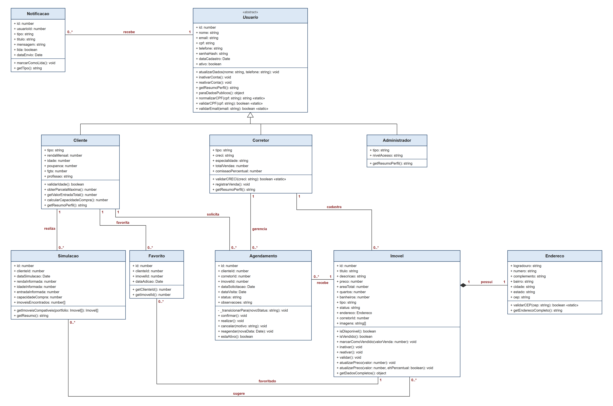

# LUNAR INTEL (Sistema Imobiliário)

Projeto semestral da disciplina de Sistema Web Orientado a Objetos (BRIPROO_2026-2).
Alunos: Bruno Hideki Uemura e José Henrique de Lima.

O cliente faz uma simulação de financiamento, o sistema mostra só os imóveis que cabem
no orçamento dele, e a partir daí ele pode pedir uma visita. O corretor recebe o pedido,
confirma, faz a visita e, se fechar negócio, marca o imóvel como vendido. O administrador
acompanha tudo por relatórios.

Feito com Node.js + Express no back-end, HTML/CSS/JS puro no front-end e os dados
salvos em arquivos JSON (pasta `data/`).

## Como rodar

Precisa ter o Node.js instalado (versão 18 ou mais nova).

```bash
npm install
npm run seed     # cria os usuários e imóveis de exemplo (apaga os dados atuais)
npm start        # abre em http://localhost:3000
npm test         # roda os testes automatizados
```

### Contas de teste (senha de todas: `123456`)

| Perfil        | E-mail                 |
|---------------|------------------------|
| Administrador | admin@lunarintel.com   |
| Corretor      | bruno@lunarintel.com   |
| Corretor      | jose@lunarintel.com    |
| Cliente       | cliente@lunarintel.com |
| Cliente       | marina@lunarintel.com  |

## O que cada perfil faz

| Perfil | Funcionalidades |
|---|---|
| **Cliente** | simula o financiamento e vê os imóveis compatíveis, busca no catálogo com filtros, favorita imóveis, pede visitas e cancela as próprias visitas, recebe notificações |
| **Corretor** | cadastra, edita, inativa, reativa e vende os imóveis do próprio portfólio (com várias fotos), confirma, reagenda, cancela e marca visitas como realizadas, vê o contato do cliente |
| **Administrador** | vê o relatório (vendas, ticket médio, taxa de conversão, vendas por corretor) e exporta em CSV, lista todos os imóveis, bloqueia e reativa usuários, consulta o log de auditoria |
| **Todos** | editam nome e telefone, trocam a senha, recuperam a senha por código |

## Organização do código

```
server.js            inicia o servidor e registra as rotas
seed.js              dados de exemplo
src/models/          classes do domínio (Usuario, Cliente, Imovel, Agendamento...)
src/services/        regras de negócio que envolvem mais de uma classe
src/repositories/    leitura e gravação dos arquivos JSON
src/routes/          endpoints da API
src/middlewares/     login, permissão por perfil e tratamento de erros
src/errors/          classes de exceção
src/config/          valores das regras de negócio (constants.js)
public/              telas (uma página por perfil)
tests/               testes automatizados (node:test)
docs/                diagrama de classes (SVG e PNG)
```

As classes do diagrama ficam em `src/models`. Os métodos que precisam buscar ou salvar
outras coisas (ex.: cadastrar imóvel, confirmar visita) ficaram nos `services`, para as
classes de domínio não dependerem dos arquivos JSON. O caminho de uma requisição é:

```
tela (public/js) -> rota (src/routes) -> middleware de login/perfil -> service -> model + repository -> data/*.json
```

## Diagrama de classes



Arquivo editável em [docs/diagrama-classes.svg](docs/diagrama-classes.svg).

## Telas

Prints em [docs/telas/](docs/telas/):

| Tela | Arquivo |
|---|---|
| Login e erro de login | `01-login.png`, `02-login-erro.png` |
| Cadastro | `03-cadastro.png` |
| Cliente: simulação e erro de validação (idade) | `04-cliente-simulacao.png`, `05-cliente-simulacao-erro-idade.png` |
| Cliente: catálogo e detalhe do imóvel | `06-cliente-catalogo.png`, `07-cliente-detalhe-imovel.png` |
| Cliente: erro de regra de negócio (RN09) | `08-cliente-erro-regra-negocio.png` |
| Cliente: minhas visitas | `09-cliente-visitas.png` |
| Corretor: portfólio, solicitações e notificações | `10-corretor-portfolio.png`, `11-corretor-solicitacoes.png`, `12-corretor-notificacoes.png` |
| Administrador: usuários, imóveis e relatório | `13-admin-usuarios.png`, `14-admin-imoveis.png`, `15-admin-relatorio.png` |

## Conceitos de POO

- **Herança e abstração:** `Cliente`, `Corretor` e `Administrador` herdam de `Usuario`.
  `Usuario` é abstrata: o construtor dá erro se alguém tentar criar um `Usuario` direto.
  Os repositórios também usam herança: todos estendem `JsonRepository`, e os erros
  estendem `AppError`.
- **Composição:** todo `Imovel` tem um `Endereco`, criado junto com ele.
- **Associação:** `Agendamento` liga cliente, corretor e imóvel. `Simulacao`, `Favorito`
  e `Notificacao` também apontam para outras classes (pelo id).
- **Polimorfismo:** `getResumoPerfil()` existe em `Usuario` e é sobrescrito em `Cliente`,
  `Corretor` e `Administrador`. O método `paraDadosPublicos()` chama `this.getResumoPerfil()`
  sem saber qual é o tipo do usuário, e cada classe devolve um texto diferente. Dá para
  ver na barra do topo depois do login (cliente mostra a renda, corretor mostra o CRECI).
- **Sobrecarga:** JavaScript não tem sobrecarga de verdade como Java, então a gente
  simulou pelos parâmetros. Em `Imovel.atualizarPreco()`:
  - `atualizarPreco(500000)` troca o preço;
  - `atualizarPreco(10, true)` reajusta o preço atual em 10%.
- **Encapsulamento:** em JS os atributos ficam públicos, mas as mudanças de estado passam
  por métodos que validam antes. Por exemplo, o status de uma visita só muda por
  `confirmar()`, `realizar()` e `cancelar()`, que chamam `_transicionarPara()` e
  bloqueiam mudanças inválidas. Um imóvel só é salvo depois de passar por `validar()`.
  E `paraDadosPublicos()` esconde o hash da senha antes de mandar o usuário para a tela.
- **Métodos estáticos:** validações que não dependem de um objeto ficam na classe:
  `Usuario.validarCPF()`, `Usuario.validarEmail()`, `Corretor.validarCRECI()` e
  `Endereco.validarCEP()`.

## Regras de negócio

| Regra | Onde está |
|---|---|
| RN01: parcela de no máximo 30% da renda | `Cliente.obterParcelaMaxima()`, `Cliente.calcularCapacidadeCompra()` |
| RN02: só vende sem visitas em aberto | `ImovelService.marcarComoVendido()` |
| RN03: visita só em imóvel disponível (pedido e confirmação) | `AgendamentoService.solicitar()` e `confirmar()` |
| RN04: no máximo 3 visitas em andamento por cliente | `AgendamentoService.solicitar()` |
| RN05: idade entre 18 e 70 anos | `Cliente.validarIdade()` |
| RN06: corretor só mexe nos próprios imóveis | `ImovelService._verificarTitularidade()` |
| RN07: admin não agenda visitas | rotas de agendamento não aceitam o perfil `ADMINISTRADOR` |
| RN08: entrada de no máximo 80% do valor do imóvel | `Simulacao.getImoveisCompativeis()` |
| RN09: mesmo imóvel: sem visita em aberto e sem pedido nos últimos 7 dias | `AgendamentoService.solicitar()` |
| RN10: cada mudança de status da visita avisa o cliente e o corretor ao mesmo tempo | `AgendamentoService._notificarEnvolvidos()` |
| RN11: formato do CRECI (ex.: 12345-F) | `Corretor.validarCRECI()` |
| RN12: imóvel inativo some das buscas | `Imovel.inativar()`, `ImovelService.listarDisponiveis()` |
| RN13: imóvel vendido fica congelado (não edita, não inativa); só imóvel inativo pode ser reativado | `Imovel.inativar()`, `Imovel.reativar()`, `ImovelService.atualizar()` |
| RN14: a data da visita precisa ser válida e no futuro (pedido e reagendamento) | `AgendamentoService._validarDataVisita()` |
| RN15: o cliente pode cancelar as próprias visitas (o corretor é avisado) | `AgendamentoService.cancelarPeloCliente()` |
| RN16: clientes compatíveis são avisados quando um imóvel é cadastrado ou reativado | `ImovelService._avisarClientesCompativeis()` |
| RN17: só dá para favoritar imóvel disponível | `FavoritoService.adicionar()` |

Os valores das regras (30%, 80%, 18–70 anos, 3 visitas, 7 dias, juros e prazo) ficam em
`src/config/constants.js`.

A RN08 tem um efeito que vale comentar: como a entrada não pode passar de 80% do preço,
um cliente com muito dinheiro guardado não vê os imóveis muito baratos (a entrada dele
seria maior que o permitido para aquele imóvel).

**Taxa de conversão** (relatório do admin): dos imóveis que receberam pelo menos uma
visita realizada, quantos foram vendidos. Fica sempre entre 0% e 100%.

## Segurança e validações

- Senhas guardadas com hash (`bcryptjs`); a sessão fica num cookie assinado (`cookie-session`).
- Cada rota confere o perfil do usuário (`requireRole`), e cada service confere se o
  registro é dele (ex.: corretor só mexe nos próprios imóveis, cliente só cancela as próprias visitas).
- A cada requisição o sistema confere se a conta ainda está ativa: se o admin bloquear
  alguém, a pessoa perde o acesso na hora. O admin não consegue bloquear a própria conta.
- O cadastro público só cria cliente ou corretor. Campos como `ativo` e `totalVendas`
  nunca vêm do formulário.
- CPF (com dígitos verificadores), e-mail, CEP, CRECI, idade, preço, quartos e datas são
  validados no servidor, não só na tela.
- A recuperação de senha responde a mesma mensagem exista o e-mail ou não, para não
  revelar quem tem conta. O código vale 15 minutos, só funciona uma vez e é descartado
  depois de 5 tentativas erradas.
- Tudo o que o usuário digita passa por `esc()` antes de aparecer na tela (evita XSS).
- **Auditoria (RNF07):** o middleware `src/middlewares/auditoria.js` registra em
  `data/auditoria.json` cadastros, logins (inclusive os que falharam), logouts e toda mudança
  de status (imóvel, visita, conta), com data e hora e quem fez. O administrador consulta na aba
  **Auditoria**. Senhas nunca entram no log.

## Persistência e tratamento de erros

- Os dados ficam em `data/*.json`. A classe `JsonRepository` faz o CRUD genérico, e cada
  entidade tem seu repositório (`ImovelRepository`, `UsuarioRepository`...). Ao ler o
  arquivo, o repositório recria os objetos das classes certas (ex.: um usuário do tipo
  CORRETOR volta como `Corretor`).
- Erros são classes que herdam de `AppError`:

  | Exceção | Status HTTP | Quando acontece |
  |---|---|---|
  | `ValidationError` | 400 | campo obrigatório vazio ou dado inválido |
  | `AuthError` | 401 | login errado, usuário não logado ou conta bloqueada |
  | `ForbiddenError` | 403 | perfil sem permissão ou registro de outra pessoa |
  | `NotFoundError` | 404 | registro não encontrado |
  | `BusinessRuleError` | 422 | regra de negócio violada ou ação em estado errado (ex.: realizar uma visita já cancelada) |
  | `PersistenceError` | 500 | falha ao ler ou salvar o arquivo JSON |

  O `errorHandler` (em `src/middlewares`) transforma qualquer erro numa mensagem simples
  para a tela, sem mostrar detalhes técnicos.

## Testes automatizados

```bash
npm test
```

São 48 testes com o `node:test`, que já vem no Node (sem instalar nada):

- `tests/models.test.js`: classes de domínio (herança, polimorfismo, sobrecarga,
  transições de status da visita, cálculo da capacidade de compra, validações).
- `tests/services.test.js`: regras de negócio de ponta a ponta (RN02, RN03, RN04, RN06,
  RN09, RN13, RN14, cadastro, recuperação de senha, relatório...).

Os testes de services usam uma pasta temporária (variável `LUNAR_DATA_DIR`), então
**não mexem** nos dados de `data/`.

## API (resumo)

Todas as rotas ficam em `/api` e respondem JSON.

| Método e rota | Quem usa | O que faz |
|---|---|---|
| `POST /auth/cadastro`, `POST /auth/login`, `POST /auth/logout` | público | conta e sessão |
| `POST /auth/recuperar-senha`, `POST /auth/redefinir-senha` | público | recuperação de senha por código |
| `GET /auth/me`, `PUT /auth/perfil`, `PUT /auth/senha`, `POST /auth/inativar` | logado | dados da própria conta |
| `GET /imoveis` (filtros: `tipo`, `quartos`, `banheiros`, `cidade`, `precoMax`), `GET /imoveis/:id` | logado | catálogo |
| `GET /imoveis/meu-portfolio`, `POST /imoveis`, `PUT /imoveis/:id`, `DELETE /imoveis/:id` | corretor | portfólio (o DELETE inativa) |
| `POST /imoveis/:id/reativar`, `POST /imoveis/:id/vender` | corretor | reativar e vender |
| `POST /simulacoes`, `GET /simulacoes` | cliente | simulação e histórico |
| `POST /agendamentos`, `GET /agendamentos` | cliente / corretor | pedir e listar visitas |
| `PUT /agendamentos/:id/confirmar`, `/reagendar`, `/realizar` | corretor | andamento da visita |
| `PUT /agendamentos/:id/cancelar` | cliente / corretor | cancelar visita |
| `GET /favoritos`, `POST /favoritos`, `DELETE /favoritos/:id` | cliente | favoritos |
| `GET /notificacoes`, `PUT /notificacoes/:id/lida` | logado | notificações |
| `GET /admin/relatorio`, `GET /admin/usuarios`, `PUT /admin/usuarios/:id/status`, `GET /admin/imoveis`, `GET /admin/auditoria` | admin | gestão e auditoria |

## Roteiro para a apresentação

1. `npm run seed` e `npm start`.
2. **Cliente** (`cliente@lunarintel.com`): fazer a simulação com os dados já preenchidos
   (renda de R$ 8.000 e R$ 45.000 de entrada dão R$ 278.323,99 de capacidade) e mostrar
   que só o Studio Pinheiros aparece. Abrir o catálogo, usar os filtros, abrir o carrossel
   de fotos, favoritar e pedir uma visita. Tentar pedir a mesma visita de novo (RN09).
3. **Corretor** (`jose@lunarintel.com`, dono do Studio Pinheiros): ver a solicitação com o
   telefone do cliente, confirmar e marcar como realizada. Tentar vender antes disso
   mostra a RN02. Depois vender e mostrar que o card fica congelado (RN13).
4. **Cliente** de novo: mostrar as notificações e o status das visitas.
5. **Admin** (`admin@lunarintel.com`): relatório, exportar CSV, bloquear um usuário e
   mostrar que ele perde o acesso na hora.
6. No terminal: `npm test` (48 testes passando).
7. Mostrar no código: `Usuario` abstrata e o polimorfismo de `getResumoPerfil()`,
   a sobrecarga de `atualizarPreco()` e as transições de `Agendamento`.

## Simplificações

- Juros de 1% ao mês e prazo de 360 meses fixos (Tabela Price).
- A recuperação de senha não manda e-mail de verdade: o código aparece no terminal do
  servidor e é digitado na tela de login.
- Conta de administrador só é criada pelo `seed.js`.
- As fotos dos imóveis são links (URLs), não upload de arquivo.
- A chave que assina o cookie de sessão vem da variável `SESSION_SECRET`; sem ela, o
  sistema usa uma chave fixa de desenvolvimento. Em produção, defina a variável.
- `npm run seed` apaga todos os dados atuais antes de criar os de exemplo.

## Publicar online (opcional)

Como os dados ficam em arquivos, o ideal é usar o Render ou o Railway, que rodam o
`npm start` normalmente. A Vercel não serve, porque não guarda arquivos entre uma
requisição e outra.
